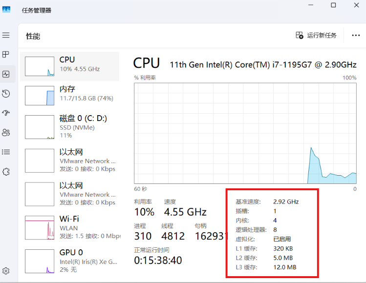
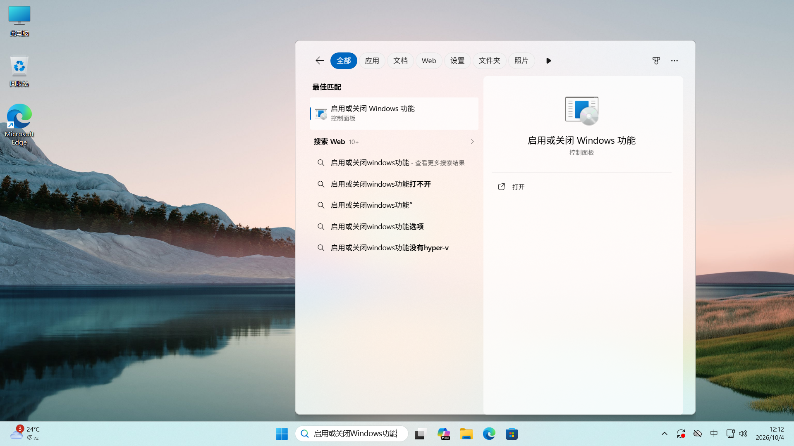
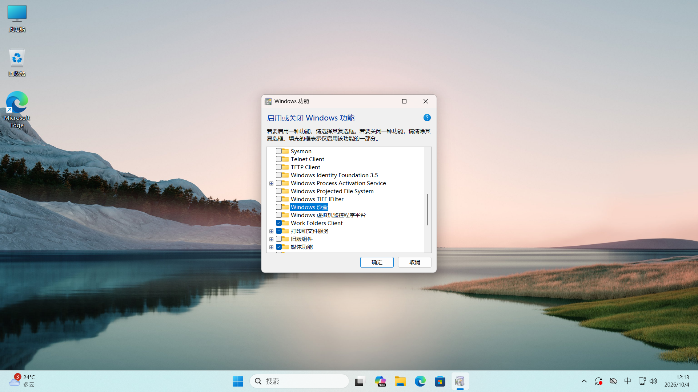
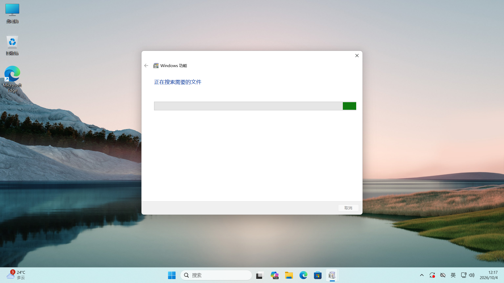
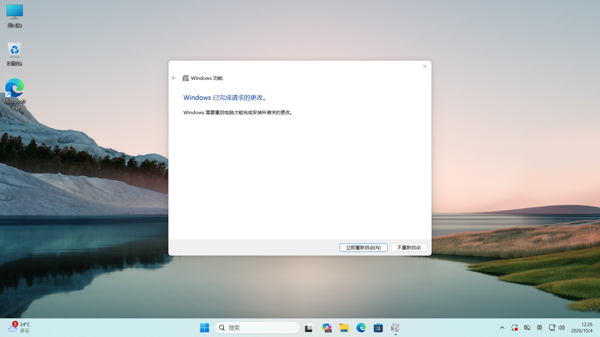
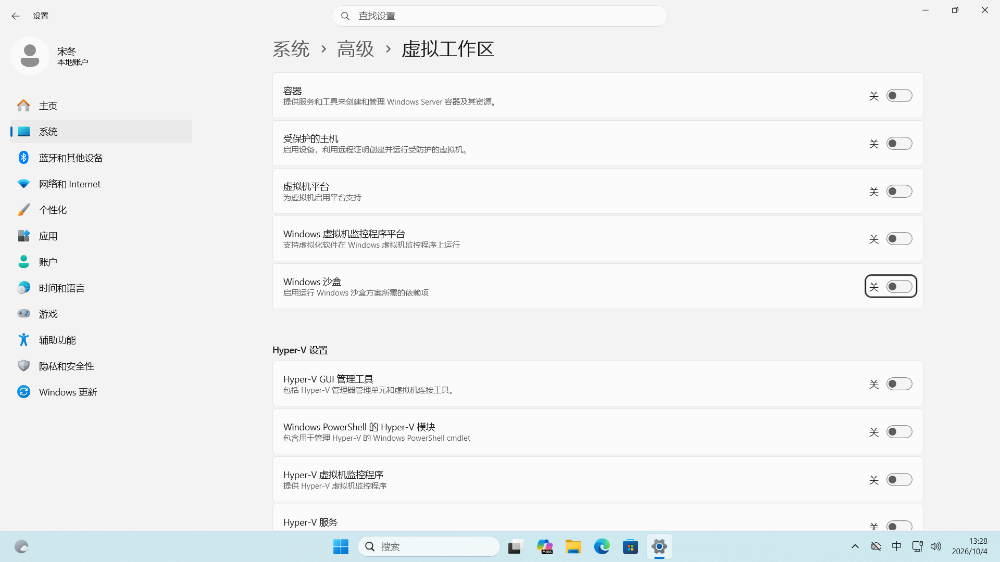
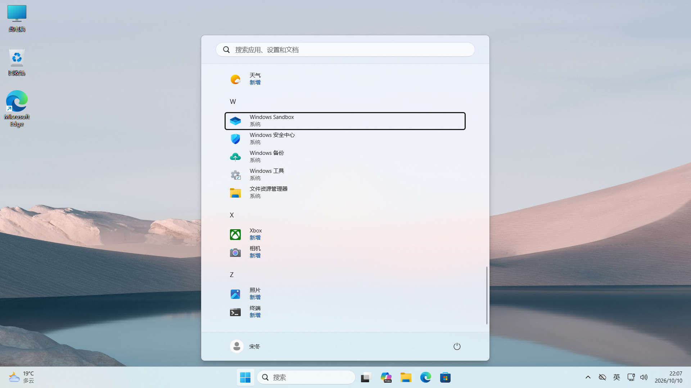
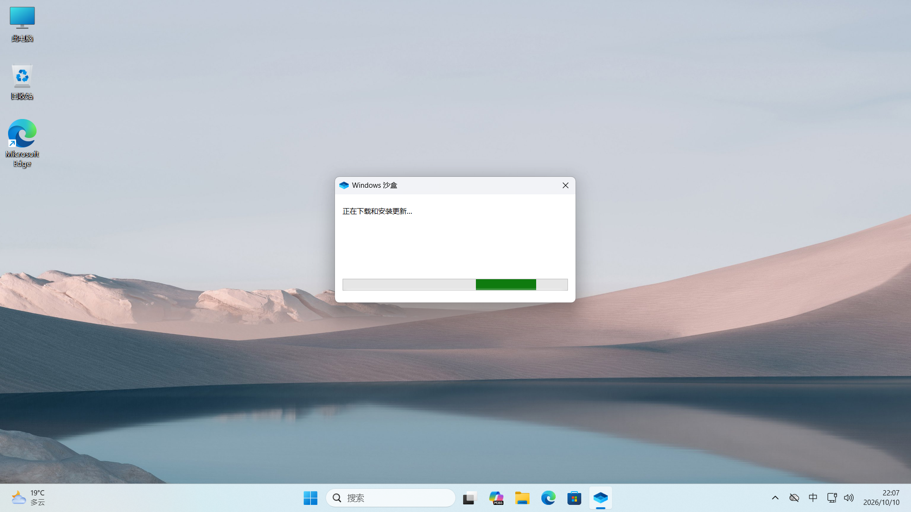
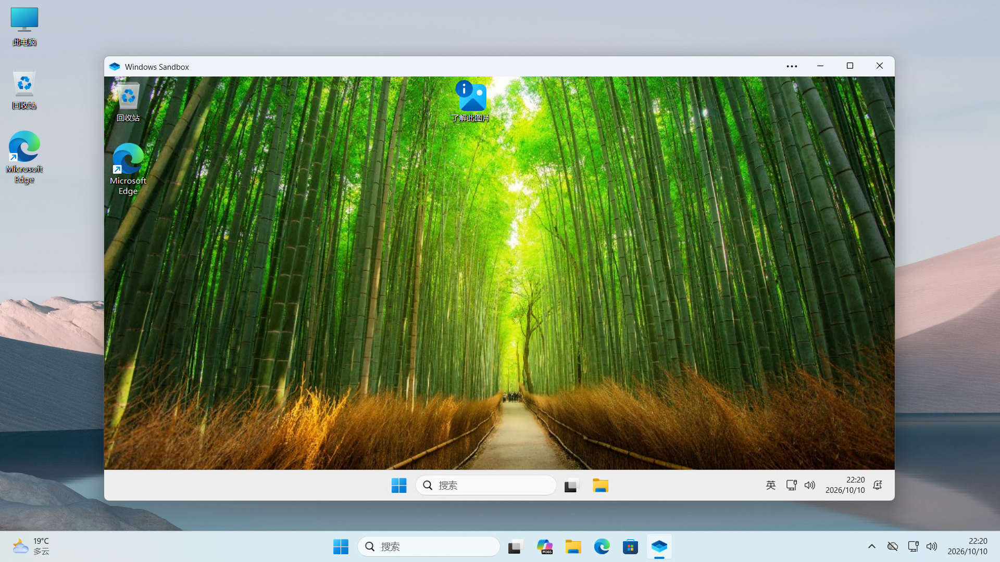

> [!info] 提示
> 本功能要求 Windows 专业版及以上 SKU，家庭版系统需要购买专业版密钥或通过激活工具进行升级。

在日常使用电脑的过程中，我们难免遇到以下情况：

- 你在网络上下载到了一个来路不明的文件，但你想要先看看这个文件会不会对系统进行破坏。
- 开发者开发了一个新软件，想要把这个软件放在一个干净的环境里进行测试。
- 专业用户需要评估某个病毒的破坏力，以及病毒篡改了哪些系统设置。

在这种情况下，若使用真实机器，无论是安全成本还是经济成本都太高了。那有没有一个经济点的方案呢？

有点，兄弟有的。那就是：***虚拟机***。

虚拟机（VirtualMachine，VM）是一种通过软件模拟而创建的计算环境，使得一台物理计算机可以运行多个独立的操作系统和应用程序。虚拟机可以在单一硬件平台上提供隔离的计算资源，模拟出多个独立的计算机系统，从而提高硬件资源利用率和灵活性。

不过，虚拟机的配置相对比较复杂，对小白来讲要熟练掌握硬件的各种概念，还要考虑各种意想不到的问题，比如说老系统加密算法与当前驱动的加密算法不兼容的疯狂报错等等。那如果我的需求就是在现代系统下跑一下软件，看看这个文件是否安全，有没有傻瓜式的操作呢？这就是本文要介绍的 Windows 沙盒。

# 一个小小的前置条件：硬件虚拟化

在讲 Windows 沙盒之前，我们需要介绍一个简单却必要的前置条件：硬件虚拟化。

简单来讲， CPU 平时只在完整的一个“房间”里干活， CPU 在这时可以自由调配自己的“员工”（即核心）。这个时候虚拟机软件来找 CPU 要资源， CPU 不知道虚拟机这个软件要独占两个员工持续工作，于是这个时候就乱了套了。而硬件虚拟化简单来讲就是告诉 CPU 有几个软件要一个独立的房间工作，这样就不会乱套了。

> [!tip] 小提示
> 为了提升硬件安全性，近5年出场的笔记本默认已经把这个设置打开了。检测你的电脑是否开启的办法是打开任务管理器（快捷键为Ctrl + Shift + Esc ），在左侧选择第二个选项卡，在右下角就可以看到虚拟化选项是否开启。
> 
>
>
>如果硬件虚拟化没有开启，请参阅[虚拟机篇](../维护记/虚拟机篇.md)，那里有更详细的开启办法。为了不破坏本文结构，这里不展开开启办法。

# 启用方法

Windows Sandbox 的开启办法主要有两种，一种是通过传统的控制面板的“启用和关闭 Windows 功能”开启，另一种是通过现代设置的高级功能开启。前者相对来讲更加通用，而后者只适用于最新版本的 Windows 11。

## 通过控制面板

在搜索框中直接搜索“启用或关闭 Windows 功能”，在搜索结果中点击打开它。

在弹出的窗口里往下翻，找到 **Windows 沙盒**，把前面的复选框打上勾，然后点击“确定”。

接下来系统会开始部署这个功能，耐心等它跑完。

部署完成后，Windows 会提示你需要重启才能生效。保存好手头的工作，点击“立即重新启动”。

## 通过设置

如果你用的是较新的 Windows 11，也可以走设置这条路：打开 **设置 → 系统 → 高级 → 虚拟工作区**，在列表里找到 **Windows 沙盒** 并勾选安装，然后同样按提示重启。

> [!tip] 小提示
> 两种方式二选一即可，装完记得重启。如果重启后开始菜单里还是找不到沙盒，先回头确认一下硬件虚拟化是不是真的开着。

# 把沙盒用起来

重启之后，在开始菜单里搜索 **Windows Sandbox**，点击打开。

第一次启动会做一点初始化准备，稍等片刻，就能看到它的桌面了。

它的界面就是一个干干净净的 Windows 桌面。你可以把宿主机上的文件直接拖进沙盒窗口，在里面运行、安装、观察它到底干了什么——哪怕这是个病毒，波及范围也只限于这个沙盒。

用完之后，直接关掉窗口就行。沙盒里的一切——文件、装过的软件、改过的设置——都会随着窗口关闭被彻底丢弃，下次打开又是一个全新的环境。

> [!warning] 注意
> 沙盒是“用完即焚”的：里面的文件不会自动保存回来。要是你在沙盒里弄出了需要保留的东西，记得在关闭前手动复制回宿主机。

# 几个容易踩的坑

- **比较吃内存**：沙盒相当于在你原有系统之外再跑一套 Windows，建议宿主机至少 8 GB 内存，开着它的时候别同时再跑太多大程序。
- **不能装驱动、也不适合打游戏**：它是一个受限的临时环境，需要重启或安装驱动的软件，以及依赖独立显卡性能的游戏，都不适合放进去跑。

> [!tip] 提示
> 根据微软官方的说法，自 Windows 11 22H2 版本开始，如果你在虚拟机内部进行重启操作（如通过开始菜单，或通过`shutdown /r /t 0`命令），系统会为你保留重启之前的所有数据。

- **会和虚拟机软件抢硬件虚拟化**：如果你装了 VMware 或 VirtualBox，可能会和沙盒背后的 Hyper-V 打架，表现为虚拟机变慢、报错甚至打不开。共存关系和处理办法，见[虚拟机篇](../维护记/虚拟机篇.md)。
- **可能会导致 Windows 更新出错**：近期部分 Windows Insider 预览用户可能会遇到 Windows 更新 0x80073712 报错，微软怀疑就是 Windows 沙盒出现的问题，官方的建议就是临时禁用沙盒来获取更新。详见 [Windows Insider 发行说明（Build 26340.9596）](https://learn.microsoft.com/en-us/windows-insider/release-notes/experimental/preview-build-26340-9596)。

