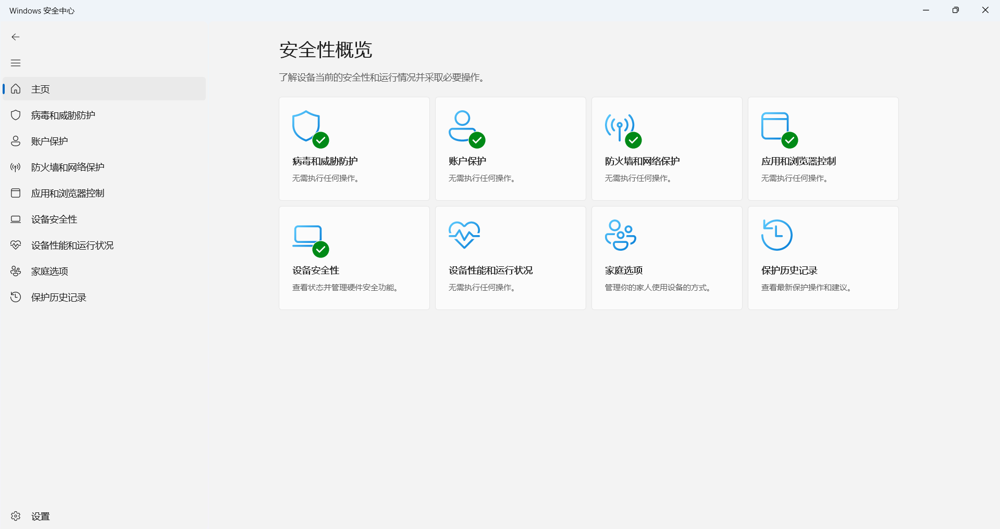
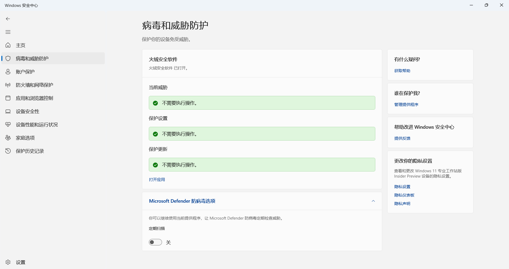
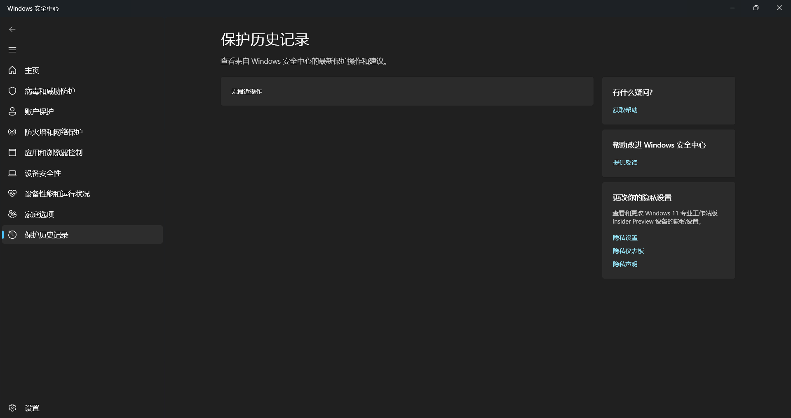
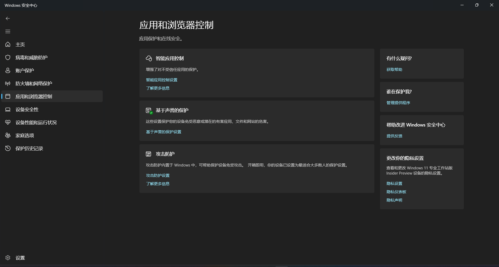
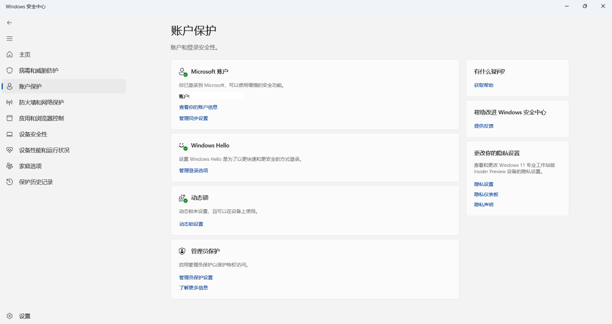
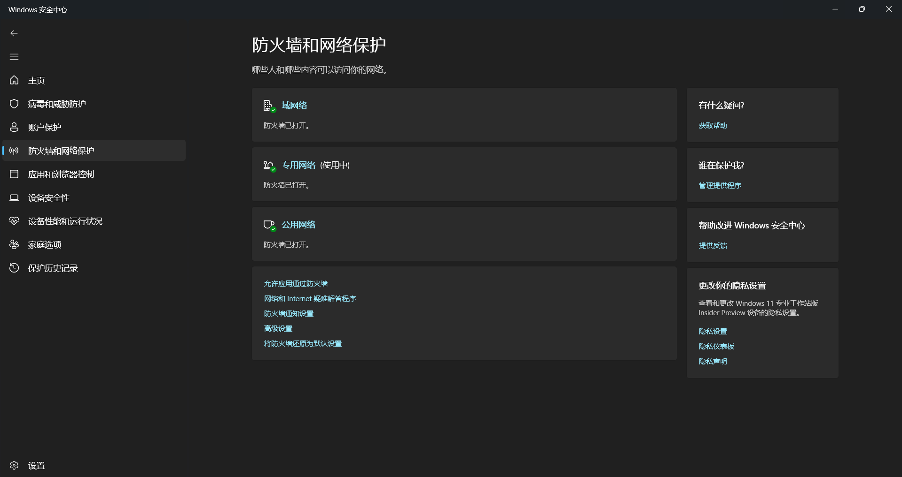
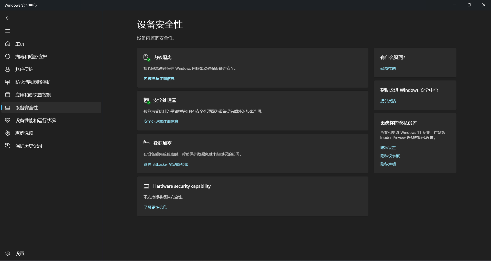
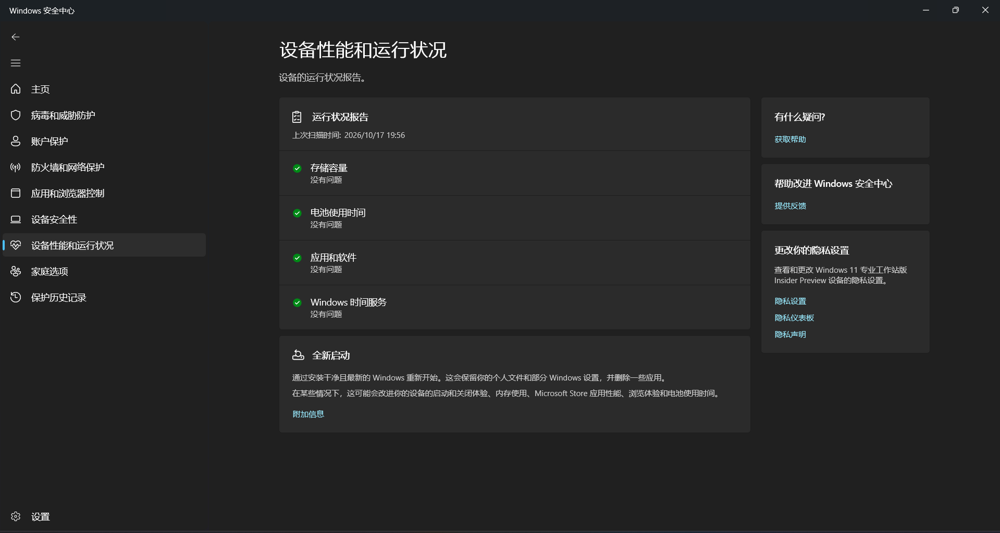
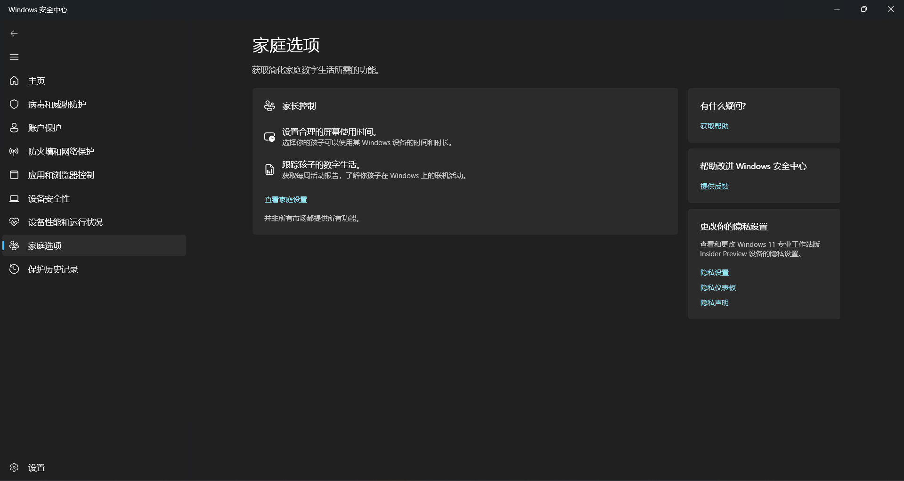

> [!info] 提示
> 本文讲的是 Windows 自带的 **Microsoft Defender 防病毒**（Windows 11 和 Windows 10 都内置）。如果你用的是精简版系统，或装了第三方安全软件，看到的界面可能略有不同。

「你电脑怎么不装杀毒软件？裸奔啊？」

如果你被朋友这样问过，那这篇文章可以帮你回答：**其实 Windows 一直自带杀毒软件**，而且默认就开着。它就是 Microsoft Defender。

# 先分清：几个都叫「Defender」的东西

"Defender" 是微软安全产品线共用的一个名字，搜索的时候很容易看串。先认清楚：

| 名字 | 是什么 | 在哪 |
| --- | --- | --- |
| **Microsoft Defender 防病毒**（Antivirus） | Windows 内置的杀毒引擎，**本文主角** | 系统自带，打开「Windows 安全中心」就能看到 |
| **Windows 安全中心**（Windows Security） | Windows 的安全控制面板，把防病毒、防火墙、账户保护等集中在一起 | 开始菜单搜索「Windows 安全中心」 |
| **Microsoft Defender 防火墙**（Firewall） | Windows 自带的网络防火墙，管哪些程序能联网 | Windows 安全中心 →「防火墙和网络保护」 |
| **Microsoft Defender**（Microsoft 365 版） | Microsoft 365 个人版/家庭版附带的跨设备安全应用，主打身份监控、网页防护和多设备管理 | 需要单独安装，支持 Windows / macOS / Android / iOS |
| **Microsoft Defender for Endpoint** | 企业级终端防护平台，学校或公司的 IT 部门在用 | 本文不涉及 |

> [!tip] 小提示
> 本文讲的是**第一行**：Windows 自带的 Microsoft Defender 防病毒，以及它的控制面板「Windows 安全中心」。如果你在 Microsoft 365 里看到一个叫 Microsoft Defender 的应用，那是另一个产品。

# 先认识一下：Defender 是什么

Microsoft Defender 防病毒（Microsoft Defender Antivirus）是 Windows 内置的杀毒软件，从你装好系统那一刻起就在工作。它会持续监视病毒、恶意软件和其他安全威胁，并自动下载更新来保持防护能力。

打个比方：它就像小区里的保安——不是那种站在门口查证件的显眼角色，而是**一直在后台巡逻**。平时你几乎感觉不到它，但真有人翻墙进来，它会第一时间拦下。

它主要靠三层能力干活：

- **实时保护**：文件一落地、程序一运行，就先扫一遍
- **行为监控**：不是只看"长什么样"，还看"干了什么"——比如某个程序偷偷改系统设置
- **启发式检测**：遇到没见过的新变种，也能根据特征判断个大概

这些能力还会和**云保护**配合：本地拿不准的文件，会快速送去云端比对，几乎即时地识别新出现的威胁。

# 它长在哪？——Windows 安全中心

Defender 的操作界面叫 **Windows 安全中心（Windows Security）**。

打开方式有两种：

1. 开始菜单搜索「**Windows 安全中心**」
2. 点任务栏右下角的**盾牌图标**（如果有）

打开后你会看到几个板块：

- **病毒和威胁防护**（本文重点）
- 账户保护
- 防火墙和网络保护
- 应用和浏览器控制
- 设备安全性
- 设备性能和运行状况

> [!tip] 小提示
> 日常 90% 的操作都在「病毒和威胁防护」里，记住这一个入口就够了。

# 病毒和威胁防护：日常就用这几个

## 扫一扫

点进「病毒和威胁防护」，最上面就是扫描入口：

- **快速扫描**：只查最容易被感染的位置，通常几分钟
- **完整扫描**：全盘检查，慢，但彻底
- **自定义扫描**：只查你指定的文件夹或磁盘
- **Microsoft Defender 脱机版扫描**：重启后在系统启动前扫描，专门对付一些"活着删不掉"的顽固病毒

平时点「快速扫描」就够用；怀疑中招、或者电脑明显变慢时，再跑一次完整扫描。

## 更新病毒库

杀毒软件靠"病毒库"（微软叫**安全智能更新**）认识新威胁。Defender 会自动更新，但你也可以手动催一下：

「病毒和威胁防护」→「**病毒和威胁防护更新**」→「检查更新」

页面上会显示当前版本号和下载日期。刚装完系统、或者很久没开机的时候，建议手动检查一次。

## 保护历史记录

Defender 拦下的东西不会直接消失，而是记在「**保护历史记录**」里。

这里能看到：它什么时候拦了什么、威胁等级、以及处理结果（已隔离 / 已删除 / 已允许）。如果你确定某个文件是误报，也可以在这里把它恢复。

> [!warning] 注意
> 恢复文件前先想清楚：Defender 报的"威胁"大多数时候不是空穴来风。拿不准就别恢复。

# 几个值得认识的开关

在「病毒和威胁防护设置」里，有几个开关值得知道：

- **实时保护**：核心开关，建议一直开着
- **云保护**：把可疑文件送去云端快速判定，建议开
- **自动提交样本**：遇到可疑文件时自动上报给微软，帮它改进（介意隐私可以关）
- **排除项**：告诉 Defender"这个文件/文件夹不用查"——**慎用**，除非你非常确定
- **勒索软件防护**：里面的「受控文件夹访问」可以保护文档、图片等文件夹不被陌生程序乱改，适合经常处理重要文件的人

# SmartScreen：Defender 的另一道门

除了查杀，Windows 还有一层"守门"机制：**Microsoft Defender SmartScreen**。

它管的是**来源可疑**这件事——不是扫描文件内容，而是看这个文件、网站**有没有信誉**：

- 你从网上下载一个 exe，它先查这个文件的数字签名和下载来源
- 你打开一个网站，它先查这个网址有没有被举报过钓鱼、挂马
- 如果查不到信誉记录，它会弹一个警告，让你自己决定

这也是为什么你会看到「**Windows 已保护你的电脑**」这种蓝屏提示——它不是 Defender 在报毒，而是 SmartScreen 在说："这个东西我没见过，你确定要开吗？"

SmartScreen 的设置入口在「**应用和浏览器控制**」→「基于信誉的保护」。

# 其他板块速览

除了上面这些，Windows 安全中心还有几个板块，日常不一定天天用，但了解一下没坏处。

## 账户保护

管账户和登录安全：Microsoft 账户状态、Windows Hello、动态锁，以及管理员保护。

## 防火墙和网络保护

控制哪些程序能联网，以及不同网络类型（域 / 专用 / 公用）下的防火墙状态。

## 设备安全性

内核隔离、安全处理器、数据加密（BitLocker）等硬件级安全能力。

## 设备性能和运行状况

生成设备健康报告，检查存储、电池、应用和 Windows 时间服务等有没有问题。

## 家庭选项

家长控制相关：屏幕使用时间、活动报告、家庭设备管理等。

# 常见问题

**Q：还需要再装一个第三方杀毒软件吗？**
一般不需要。Defender 对普通用户完全够用。而且如果你装了别的杀毒软件，Defender 会自动让位关闭；卸载后它又会自动恢复。

**Q：能同时装两个杀毒软件吗？**
不建议。两个杀毒软件容易互相打架、拖慢系统，还可能出现"都以为对方在管"的尴尬局面。

**Q：Defender 报毒了，但我觉得是误报怎么办？**
先在「保护历史记录」里看清它拦的是什么。如果确认是误报，可以恢复并把文件加入排除项——但请务必确认来源可靠。

**Q：任务管理器里「Antimalware Service Executable」占 CPU 正常吗？**
正常。那是 Defender 的扫描进程，平时占用很低；它在后台扫描或更新时会短暂升高。如果长期高占用，可以检查是不是正在做完整扫描。

**Q：可以把 Defender 关掉吗？**
技术上可以，但不建议。关掉等于把系统的第一道防线撤了，除非你有明确理由（比如临时排障），否则保持开启。

